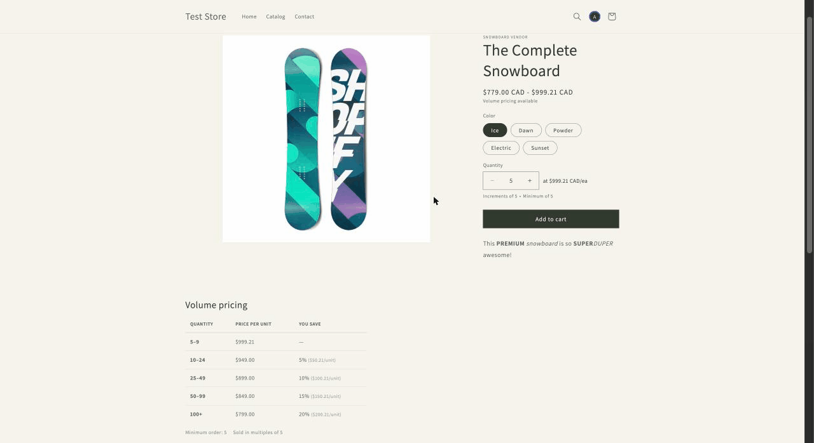
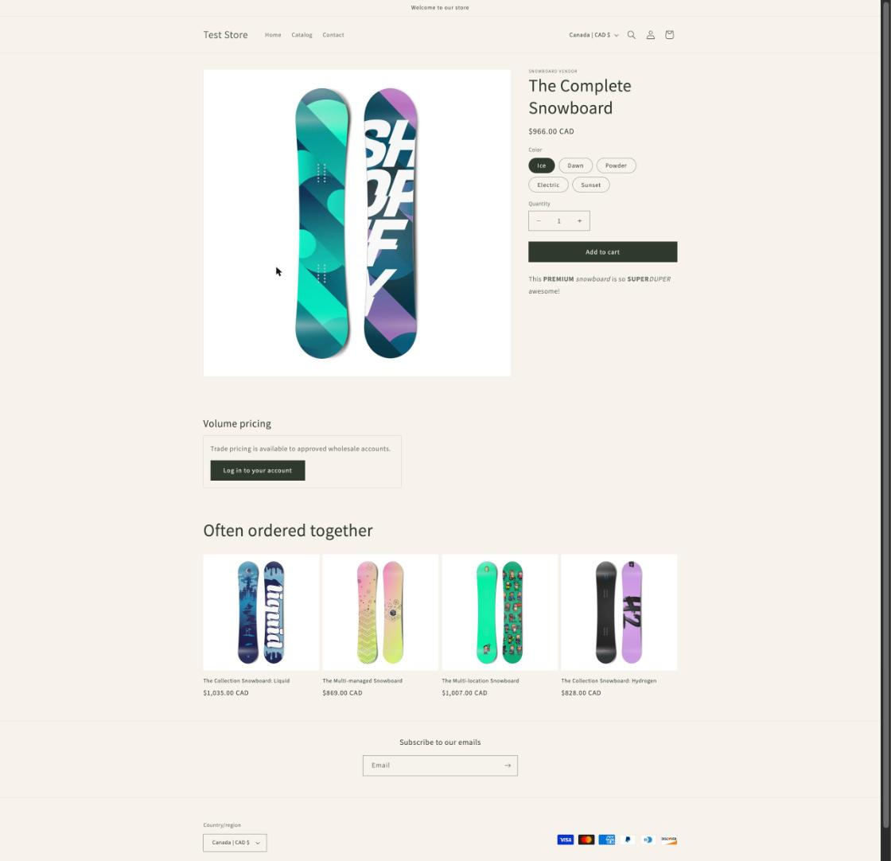

# B2B tier pricing section for Shopify (Online Store 2.0)

A custom section for Dawn-based themes that shows volume price breaks on a
product page, gated so retail traffic doesn't see trade pricing.



Built to sit on a dedicated `product.b2b` template alongside the standard
product template, so wholesale products get the pricing table and DTC products
don't.

## What it does

- Reads the variant's real catalog price breaks (`variant.quantity_price_breaks`)
  when B2B is set up, so the table reflects whatever catalog is assigned to the
  buyer's company.
- Falls back to merchant-configured tiers (section blocks, up to 4) when the
  variant has no catalog breaks, so the section is still useful on a store
  without B2B.
- Fills in the `1–n` row that catalog breaks leave out, so single-unit pricing
  isn't implied to be unavailable.
- Surfaces order rules from `variant.quantity_rule` (minimum, increment,
  maximum) but only when they differ from the defaults.
- Shows the buyer's active company and location, with a link to switch when the
  customer has more than one.
- Gates visibility three ways: B2B customers only, any logged-in customer, or
  everyone. Defaults to B2B only.
- Re-renders the table through the Section Rendering API when the buyer picks
  another variant, so each variant's own breaks show without a page reload.

## Trade buyer vs. normal shopper

| B2B buyer | Logged-out visitor |
|---|---|
|  |  |

## Files

| File | Purpose |
|---|---|
| `sections/b2b-tier-pricing.liquid` | Section, schema, blocks, presets |
| `snippets/b2b-price-break-table.liquid` | Renders catalog price breaks |
| `assets/section-b2b-tier-pricing.css` | Styles, including a mobile stacked layout |
| `assets/b2b-tier-pricing.js` | Refreshes the section on variant change |
| `templates/product.b2b.json` | JSON template wiring the section into a product page |

## Install

Copy the five files into a Dawn-based theme, keeping the directory structure.

```
shopify theme dev --store your-store.myshopify.com
```

Then either assign the `b2b` product template to a product under
**Product → Theme template**, or add the section to any product template from
the theme editor.

## Notes on the Liquid

`customer.b2b?` is the check for a B2B buyer. It's false for retail customers
and for logged-out visitors, which is why the gate defaults to it.

Fallback tier prices are derived from `variant.price` with integer math on
cents (`price | times: remainder | divided_by: 100`) rather than a hardcoded
price setting, so the tiers follow the product price instead of drifting from
it when the merchant changes it.

The savings percentage is computed against the variant's base price, not
against the previous tier. That matches how buyers read a volume table: the
number answers "what do I save versus buying single units."

## Tested on

- Dawn 16.0.0, development store with B2B enabled
- One company with one location, catalog carrying quantity price breaks and
  quantity rules (minimum 5, increments of 5)
- Verified: B2B buyer sees the catalog breaks, logged-out visitor sees the
  login prompt, switching variant re-renders the table with that variant's
  breaks
